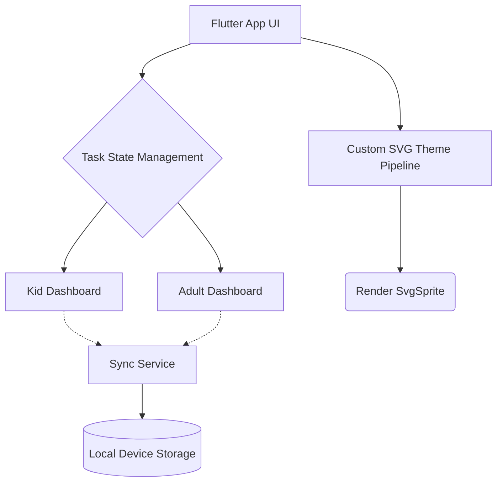

# chore_sync_app


A family-friendly Flutter application for chore syncing and point rewards.

## Key Features
- **Local-first Synchronization**: Ensures changes are updated quickly and synced reliably to the local device network.
- **Custom SVG Themes**: Built-in `SvgSprite` functionality enables advanced UI skinning through SVG spritesheets.
- **Task State Management**: Easy role separation (kid vs. adult) and point-based reward systems.
- **Rust Integration**: Leverages `flutter_rust_bridge` for fast background processing and heavy lifting.

## Architecture Diagram



## Quickstart

### Prerequisites
- Install Flutter: [Flutter Installation Guide](https://docs.flutter.dev/get-started/install)
- (Optional) Install Rust toolchain if you need to build the Rust core backend.

### Running the App
1. Clone this repository.
2. Change your working directory to the app folder:
   ```bash
   cd chore_sync_app
   ```
3. Fetch dependencies:
   ```bash
   flutter pub get
   ```
4. Run the app:
   ```bash
   flutter run
   ```

### Running Tests
To verify everything works correctly, you can run all tests using:
```bash
flutter test
```

## Project Directory Structure

- `lib/` - Main Flutter application code.
  - `providers/` - State management (e.g., AppState).
  - `screens/` - Dashboard and role selection UIs.
  - `services/` - Core logic services like Sync and Storage.
  - `widgets/` - Reusable UI components like `SvgSprite` and `SkinnedButton`.
  - `src/rust/` - Generated FFI bridge code to interface with Rust.
- `rust/` - The Rust backend codebase for core logic processing.
- `test/` - Comprehensive unit and widget tests.
- `assets/` - Static assets including custom SVG UI skins.

## Getting Started

This project is a starting point for a Flutter application.
For help getting started with Flutter development, view the
[online documentation](https://docs.flutter.dev/), which offers tutorials,
samples, guidance on mobile development, and a full API reference.
